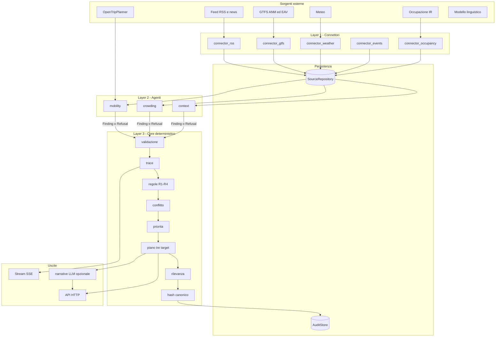
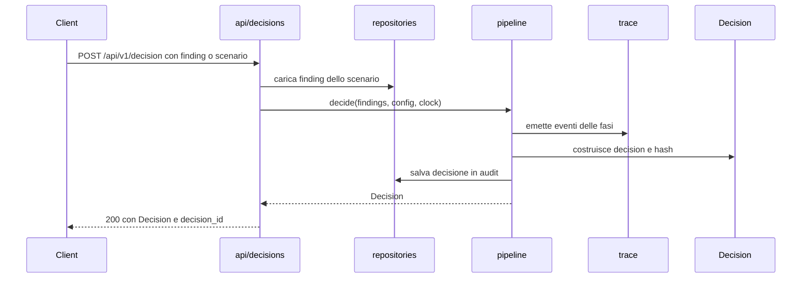

[PIANIFICATO]

# Architettura

Architettura del backend: componenti, dipendenze, flusso dei dati, punti di innesto e regole che non si violano.

## 1. Principio guida

Il cuore del sistema e' una funzione pura.

```
decide(findings: list[Finding | Refusal], config: Config, clock: Clock) -> Decision
```

Nessun input/output, nessuna rete, nessun database, nessun LLM, nessun orologio implicito. Tutto cio' che non e' funzione pura e' un adattatore sostituibile.

Conseguenza operativa: la demo puo' girare sull'intero sistema oppure solo sul core con fixture, con lo stesso risultato. Ogni adattatore puo' essere spento senza spegnere il sistema.

## 2. Componenti



`SourceRepository` e' un'interfaccia. Il core non la conosce: riceve gia' i finding.

## 3. Dipendenze

Regola unica: una dipendenza punta solo verso il basso.

```
api -> services -> repositories -> db
                  domain (nessuna dipendenza in uscita)
```

| Componente | Puo' importare | Non puo' importare |
|---|---|---|
| `domain/` | standard library, `pydantic` | `api`, `services`, `repositories`, `db` |
| `services/orchestrator/` | `domain`, `shared/schemas` | `api`, `db`, `httpx`, `psycopg` |
| `services/agents/*` | `domain`, `shared/schemas`, il proprio repository, OTP solo per mobility | gli altri agenti, `api` |
| `services/connectors/*` | `domain`, il proprio repository | `services/agents`, `services/orchestrator` |
| `repositories/` | `domain`, driver di database | `services`, `api` |
| `api/` | `services`, `shared/schemas` | `repositories`, `db`, driver |

Le regole sono verificate da un test che analizza gli import via AST. Una regola non verificata e' una convenzione, e una convenzione decade al primo giorno di fretta.

## 4. Il core deterministico

### 4.1 Fasi

| Fase | Input | Output | Puro |
|---|---|---|---|
| validazione | finding grezzi | finding validati con `finding_ref` | si |
| trace | eventi emessi | lista ordinata di passi | si |
| regole | finding validati, config | quattro `RuleResult` | si |
| conflitto | finding, esiti regole | `Conflict` | si |
| priorita' | conflitto, finding | risoluzione con priorita' applicata | si |
| piano | risoluzione, config | item per i tre target | si |
| rilevanza | item, config | punteggio e contributi per target | si |
| hash | decision senza timestamp | `decision_id` | si |

Ogni fase riceve un valore e restituisce un valore. Nessuna fase legge stato globale.

### 4.2 Trace

La trace e' l'unica sorgente del reasoning log.

```
trace.rule_evaluated(rule_id, agents, fired, reason)
trace.conflict_detected(description, zone)
trace.priority_applied(priority, winner)
trace.plan_item_created(target, action_ref)
```

`Decision.reasoning_log` e' una proiezione della trace. Il log non puo' divergere da cio' che e' successo, perche' e' generato dagli stessi eventi.

La stessa trace alimenta lo stream SSE. Unica sorgente, due consumatori.

### 4.3 Determinismo

Condizioni necessarie, tutte verificabili:

- nessun `datetime.now()` nel core, l'orologio e' iniettato e default `Europe/Rome`;
- nessun `set` iterato senza ordinamento esplicito;
- nessun `dict` iterato senza ordinamento dichiarato;
- float arrotondati prima dell'hash: rilevanza a 4 decimali, confidence a 2;
- JSON canonico con chiavi ordinate e separatori stabili;
- `timestamp` escluso dal calcolo dell'hash ma conservato accanto ad esso.

`decision_id = sha256(canonical_json(decision_senza_timestamp))[:16]`. Stesso input, stesso identificatore.

## 5. I punti di innesto

Il sistema e' costruito come una spina dorsale piu' quattro corsie indipendenti. Ogni corsia si attacca in un punto dichiarato e puo' essere spenta.

| Corsia | Punto di innesto | Sostituto se spenta |
|---|---|---|
| Persistenza | `SourceRepository` | `InMemorySourceRepository` da fixture |
| Connettori | `SourceRepository.write` | fixture precaricate |
| Routing | `MobilityAgent.routing` | fixture di risposta OTP registrata |
| Linguaggio | `narrative.render` | template deterministico |

Un punto di innesto e' un'interfaccia con due implementazioni. Se un terzo componente deve essere spento senza sostituto, non e' una corsia, e' una dipendenza obbligatoria: va dichiarata come tale.

## 6. Struttura dei file

```
backend/app/
  main.py                     applicazione, inclusione router, handler errori
  api/v1/
    findings.py               POST finding per i tre agenti
    decisions.py              POST decision
    scenarios.py              GET scenario, GET stream SSE
  api/middleware/
    errors.py                 gestione errori con problem+json
  services/
    orchestrator/
      config.py               caricamento e validazione configurazione
      rules.yaml              soglie e precedenza
      relevance.yaml          pesi per target
      models.py               RuleResult, Conflict, Resolution
      triggers.py             evaluate_r1..r4
      conflicts.py            detect_conflict, resolve_conflict
      priorities.py           mappa P1-P3 e ordinamento
      reasoning.py            build_reasoning_log dalla trace
      plan.py                 build_plan
      relevance.py            score_relevance con contributi
      pipeline.py             decide, composizione delle fasi
      narrative.py            render con LLM opzionale
    agents/
      mobility/               agente Mobilita, otp_client, itineraries
      crowding/               agente Affollamento
      context/                agente Contesto
    connectors/
      base.py                 interfaccia comune
      rss/                    parser, derivazione severity e confidence
      gtfs/
      weather/
      events/
      occupancy/
  domain/
    models/                   finding, decision, refusal, trace, config
    logic/                    funzioni pure: regole, priorita', punteggio
  repositories/
    base.py                   interfaccia SourceRepository, AuditStore
    memory.py                 implementazione in memoria
    postgres.py               implementazione Postgres
  db/
    session.py                connessione e sessione
    migrations.py             applicazione idempotente delle migrazioni
  utils/
    canonical.py              JSON canonico e hash
    clock.py                  orologio iniettabile
```

## 7. Flusso di una richiesta di decisione



Lo stream SSE segue lo stesso percorso, con `api/scenarios` che inoltra gli eventi man mano che la pipeline li emette.

## 8. Tre layer, versione operativa

| Layer | Responsabilita' | Chi produce | Chi consuma |
|---|---|---|---|
| 1 connettori | portare dati normalizzati, dichiarare la fonte, non decidere | connettori | repository |
| 2 agenti | interpretare snapshot, produrre finding o rifiuto | agenti | orchestratore |
| 3 orchestratore | decidere con regole e priorita', motivare | pipeline | API e presentazione |

Un componente che attraversa due layer viola il confine. Il caso tipico da evitare: un connettore che produce un finding, o un endpoint che applica una regola.

## 9. Cosa l'architettura esclude

- Il core che legge da rete o database.
- L'orchestratore che conosce OpenTripPlanner.
- Gli agenti che si parlano.
- Un endpoint con logica di dominio.
- Un connettore con soglie.
- Un LLM che decide trigger, conflitti, priorita' o punteggi.
- Un timestamp implicito in un calcolo.

Queste esclusioni sono verificate da test, non da revisione manuale.
