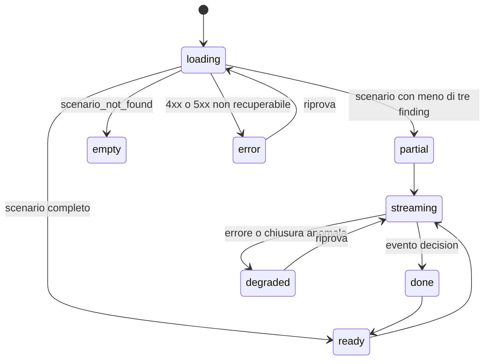

[PIANIFICATO]

# Client API

Come il frontend consuma il backend: tipi, client HTTP, stream, macchina a stati, resa degli errori. I payload di riferimento sono in [API.md](../../backend/docs/API.md); qui c'e' la traduzione lato client.

## 1. Tipi

Un solo file, `lib/contracts.ts`. I tipi si scrivono a mano e i test li confrontano con le costanti dei campi attesi: la generazione automatica da OpenAPI e' un miglioramento successivo, non un prerequisito.

```ts
export type AgentName = "mobility" | "crowding" | "context";
export type Severity = "low" | "medium" | "high" | "critical";
export type FindingType = "route_disruption" | "route_alternative" | "density_alert" | "impact_assessment";
export type PlanTarget = "operator" | "tourist" | "citizen";
export type RuleId = "R1_line2_crowding" | "R2_conflict_route_vs_density" | "R3_weather_capacity" | "R4_event_surge";

export type Finding = {
  agent: AgentName;
  type: FindingType;
  content: Record<string, unknown>;
  confidence: number;
  severity: Severity;
  source_id: string;
  data_reference: string;
  is_simulated: boolean;
  timestamp: string;
};

export type Trigger = { rule_id: RuleId; agents_involved: AgentName[] };
export type Conflict = { detected: boolean; description: string };
export type PlanItem = { priority: number; action: string; target: PlanTarget; rationale: string };
export type ReasoningStep = { step: number; agent: string; finding_ref: string; rule_applied: string; outcome: string };

export type Decision = {
  trigger: Trigger;
  conflict: Conflict;
  plan: PlanItem[];
  reasoning_log: ReasoningStep[];
  confidence: number;
  timestamp: string;
};

export type Refusal = { agent: AgentName; reason_code: string; missing_input: string[]; detail: string };

export type Contribution = { feature: string; value: number; weight: number; contribution: number };
export type ScoredItem = { plan_index: number; score: number; contributions: Contribution[] };
export type TargetRelevance = { order: number[]; items: ScoredItem[] };
export type RelevanceScore = { rounding: number; targets: Record<PlanTarget, TargetRelevance> };

export type Narrative = { mode: "replay" | "live" | "off"; items: { plan_index: number; texts: { it: string; en?: string } }[] };

export type FindingResponse = { contract_version: string; finding: Finding; finding_ref: string };
export type DecisionResponse = { contract_version: string; decision_id: string; decision: Decision; relevance: RelevanceScore; narrative: Narrative };
export type ScenarioResponse = { contract_version: string; scenario_id: string; title: string; findings: Finding[]; vehicle_positions: VehiclePosition[] };

export type Problem = {
  type: string; title: string; status: number; code: string;
  field?: string; detail: string; instance: string; refusal?: Refusal;
};
```

`VehiclePosition` e' l'unica struttura non definita in [CONTRACTS.md](../../backend/docs/CONTRACTS.md): descrive un dato grezzo per la mappa e non fa parte di un contratto congelato. I suoi campi sono quelli elencati in [API.md](../../backend/docs/API.md) sezione 4.

### 1.1 Accessor su `content`

`content` e' aperto: si legge con funzioni che restituiscono `undefined` quando il campo manca, mai con un default.

```ts
const num = (c: Record<string, unknown>, k: string): number | undefined =>
  typeof c[k] === "number" ? (c[k] as number) : undefined;

export const density = (f: Finding) => num(f.content, "density");
export const congestion = (f: Finding) => num(f.content, "congestion");
export const zoneId = (f: Finding) => (typeof f.content.zone_id === "string" ? f.content.zone_id : undefined);
export const heavyRain = (f: Finding) => (typeof f.content.heavy_rain === "boolean" ? f.content.heavy_rain : undefined);
export const expectedAttendance = (f: Finding) => num(f.content, "expected_attendance");
```

Se un accessor restituisce `undefined`, l'interfaccia non mostra quel dato. Non sostituisce, non arrotonda, non stima.

## 2. Client HTTP

Un solo modulo, `lib/api.ts`. Nessun componente fa `fetch` direttamente.

```ts
const BASE = process.env.NEXT_PUBLIC_API_BASE_URL ?? "http://localhost:8000";

export class ApiError extends Error {
  constructor(readonly problem: Problem) { super(problem.detail); }
}

async function request<T>(path: string, init?: RequestInit): Promise<T> {
  const res = await fetch(`${BASE}${path}`, {
    ...init,
    cache: "no-store",
    headers: { "Content-Type": "application/json", ...(init?.headers ?? {}) },
  });
  const body = await res.json();
  if (!res.ok) throw new ApiError(problemSchema.parse(body));
  return body as T;
}
```

Regole:

| Regola | Motivo |
|---|---|
| `cache: "no-store"` su ogni richiesta di decisione | la decisione e' riproducibile, non cacheabile |
| una sola base URL da ambiente | nessun path hardcoded nei componenti |
| nessun retry automatico sulle `POST` | un retry silenzioso falserebbe il confronto dei `decision_id` |
| un retry con backoff sulle sole `GET /scenario` | la prima schermata deve reggere un backend appena avviato |
| timeout client di 5 secondi con `AbortController` | oltre, lo stato diventa `degraded` |

## 3. Stream SSE

Un hook, `useDecisionStream(scenarioId)`. Restituisce i passi accumulati e lo stato della connessione.

```ts
export function useDecisionStream(scenarioId: string) {
  const [steps, setSteps] = useState<RuleStep[]>([]);
  const [status, setStatus] = useState<"idle" | "open" | "done" | "degraded">("idle");

  useEffect(() => {
    const es = new EventSource(`${BASE}/api/v1/scenario/${scenarioId}/stream`);
    setSteps([]);                       // la riconnessione riparte da capo
    setStatus("open");

    es.addEventListener("rule_evaluated", (e) => setSteps((s) => [...s, JSON.parse((e as MessageEvent).data)]));
    es.addEventListener("conflict_detected", ...);
    es.addEventListener("priority_applied", ...);
    es.addEventListener("plan_item_created", ...);
    es.addEventListener("decision", () => { setStatus("done"); es.close(); });
    es.addEventListener("error", () => { setStatus("degraded"); es.close(); });

    return () => es.close();
  }, [scenarioId]);

  return { steps, status };
}
```

Regole:

- Si usa `EventSource`: nessun header custom, nessun `fetch` streaming. Il backend non richiede preflight sullo stream.
- La timeline si azzera all'apertura: lo stream e' one-shot e una riconnessione automatica duplicherebbe i passi (FE-REQ-16).
- All'evento `decision` la connessione si chiude dal client, oltre che dal server.
- `degraded` non svuota la schermata: la decisione ottenuta con `POST /decision` resta visibile.

## 4. Macchina a stati della schermata



| Stato | Cosa e' a schermo |
|---|---|
| `loading` | scheletri, intestazione con lo scenario richiesto |
| `partial` | finding presenti + card "dato non disponibile" |
| `ready` | dati e decisione, timeline vuota |
| `streaming` | timeline che si popola, `aria-live` attivo |
| `done` | timeline completa, `decision_id` visibile |
| `degraded` | banner con la sorgente sostituita, contenuto integro |
| `empty` | stato vuoto con gli scenari noti |
| `error` | `ErrorBanner` con `code`, `detail`, "riprova" |

La decisione si chiede prima di aprire lo stream: se lo stream non parte, la schermata e' comunque completa.

## 5. Resa degli errori

Ogni `code` ha una resa dichiarata. Nessun caso generico lascia un messaggio del server a schermo.

| `code` | HTTP | Dove si vede | Resa |
|---|---|---|---|
| `invalid_finding` | 422 | card del finding, se `field` la identifica; altrimenti banner | testo "dato non conforme" + `field`; il resto della schermata resta valido |
| `agent_mismatch` | 422 | card dell'agente | "il dato non appartiene a questo agente" |
| `missing_finding` | 422 | area decisione | banner "nessun finding disponibile", piano non mostrato |
| `agent_refusal` | 422 | card dell'agente | card "dato non disponibile" con `refusal.reason_code` e `refusal.detail` |
| `scenario_not_found` | 404 | intera schermata | stato `empty`, scenario richiesto, elenco degli id noti |
| `upstream_timeout` | 503 | banner di sistema | `degraded`, "sorgente esterna non raggiungibile", contenuto resta |
| `upstream_unavailable` | 503 | banner di sistema | come sopra |
| `llm_unavailable` | 200 | `PlanCard` | non e' un errore: chip "testo da template" quando `narrative.mode !== "live"` |
| `config_invalid` | 500 | intera schermata | `error` con "configurazione del backend non valida", riprova disabilitato |
| `internal_error` | 500 | intera schermata | `error` con `detail` generico e pulsante riprova |

Errori di rete senza risposta: stato `degraded` con "backend non raggiungibile". Nessuno stack trace, nessun messaggio in inglese del runtime a schermo.

## 6. Controllo della versione del contratto

```ts
const EXPECTED_CONTRACT_VERSION = "1.0.0";

if (body.contract_version !== EXPECTED_CONTRACT_VERSION) {
  // banner permanente, campi sconosciuti non interpretati
}
```

Un disallineamento non blocca la schermata: mostra il banner e rende i campi noti. Il caso opposto, un crash per un campo nuovo, e' peggio di un avviso.

## 7. Determinismo visibile

Il pulsante "ripeti" esegue due `POST /decision` consecutive e confronta i `decision_id`.

```ts
const a = await postDecision({ scenario_id });
const b = await postDecision({ scenario_id });
const same = a.decision_id === b.decision_id;
```

Il risultato si mostra in una riga, con entrambi i valori se diversi. Nessuna animazione: il punto e' che il valore non cambia.

## 8. Cosa il client non fa

- Non ricalcola `finding_ref`, `decision_id`, punteggi o ordinamenti.
- Non ricostruisce `reasoning_log` dagli eventi SSE: lo chiede al backend, e usa gli eventi solo per l'animazione. Se i due divergono, vince il backend.
- Non interpreta `content` oltre i cinque accessor.
- Non richiede endpoint non elencati in [API.md](../../backend/docs/API.md).
- Non chiama il database, le fonti esterne o OTP.
- Non mostra `reasoning_log` a turista e cittadino.
